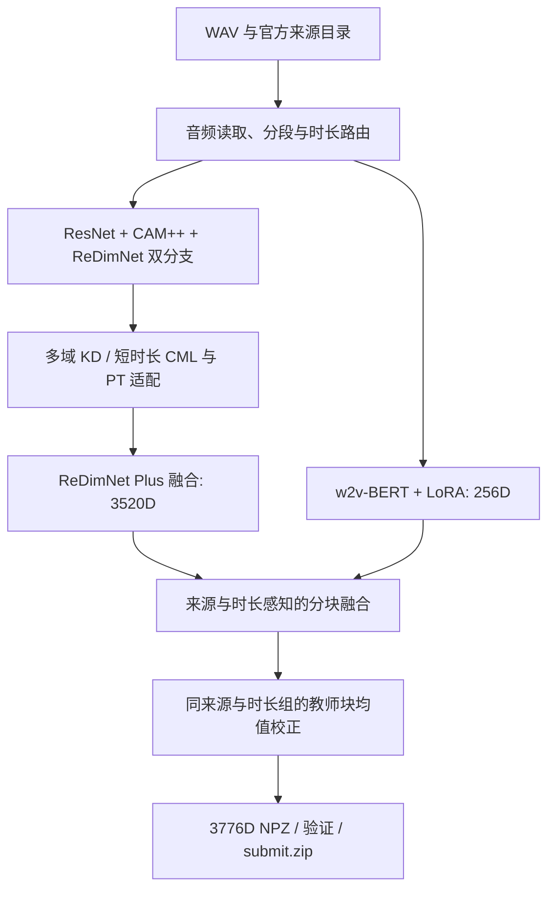

# 方法与推理流程

## 1. 任务与表示

系统将语音映射为固定 3776 维的单位向量。两个向量的余弦相似度用于后续说话人匹配；赛事试验列表与评分由外部评测处理，运行时只提取语音表示。



## 2. 多主干与适配器

ResNet 256D 与 CAM++ 192D 构成 448D 基础表示；两个 ReDimNet 分支各提供 192D，合成 832D 基础空间。适配后的锚点与三组度量专家拼接为 3328D，再加入 192D ReDimNet Plus 分支，形成 3520D 表示。Plus 分支按来源启用，未启用时用零向量占位。融合 256D 教师特征后，输出维度为 3776D。

适配部分包括多域输出空间蒸馏、短语音度量变换，以及 w2v-BERT 的 LoRA 与说话人适配头。LoRA 作用于编码器索引 20–23 的四层 Q/V 投影，`rank=8`、`alpha=16`；训练时同时优化说话人适配头和分类器，推理时使用合并后的模型参数。

## 3. 分块融合

对单位向量 `a`、`t` 和教师融合系数 `α`，使用 `concat(sqrt(1-α)·a, sqrt(α)·t)` 构造融合表示。计算两个嵌入的余弦相似度时，教师块的系数为两侧 `sqrt(α)` 的乘积。

| 来源路由 | 常规时长 full3 | 0.5 秒策略 short05 | 1 秒策略 short10 |
| --- | ---: | ---: | ---: |
| source 1 | 0.45 | 0.32 | 0.25 |
| source 2 | 0.60 | 0.1090909090909091 | 0.70 |

融合系数定义在 [calibrated_teacher_fusion.py](../inference/calibrated_teacher_fusion.py) 及其策略模块中。时长在 0.35–0.65 秒时使用 short05，在 0.85–1.15 秒时使用 short10。未命中这两个窗口时，至少 1 秒的音频进入 full3，教师输入取不超过 3 秒的中心片段；不足 1 秒的音频只使用声学表示。

## 4. 批次教师均值校正

先提取当前输入批次的全部嵌入，再按官方来源和已有时长策略分组。每组至少 8 条，且教师路径有效时，对恢复出的单位教师向量执行：

```text
μg = mean(ti for i in group g)
ti' = normalize(ti − λg · μg)
zi  = concat(unchanged acoustic block, sqrt(αg) · ti')
```

source 1 的 `λ=1.05`，source 2 的 `λ=1.00`，校正仅作用于 256 维教师子空间。少于 8 条的分组，以及未启用教师特征的语音，保留校正前的表示。

## 5. 工程协议

WAV 的相对路径逐条映射为 NPZ。程序检查文件数量、名称、字段、dtype、维度、有限值和单位范数后，生成 `submit.zip`。Plus 辅助分支的异常按模块内策略处理；无效嵌入或输出格式错误会终止结果写入。
